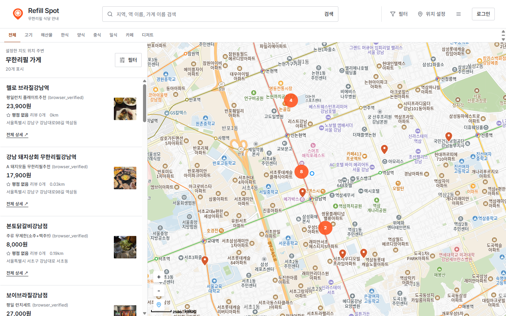
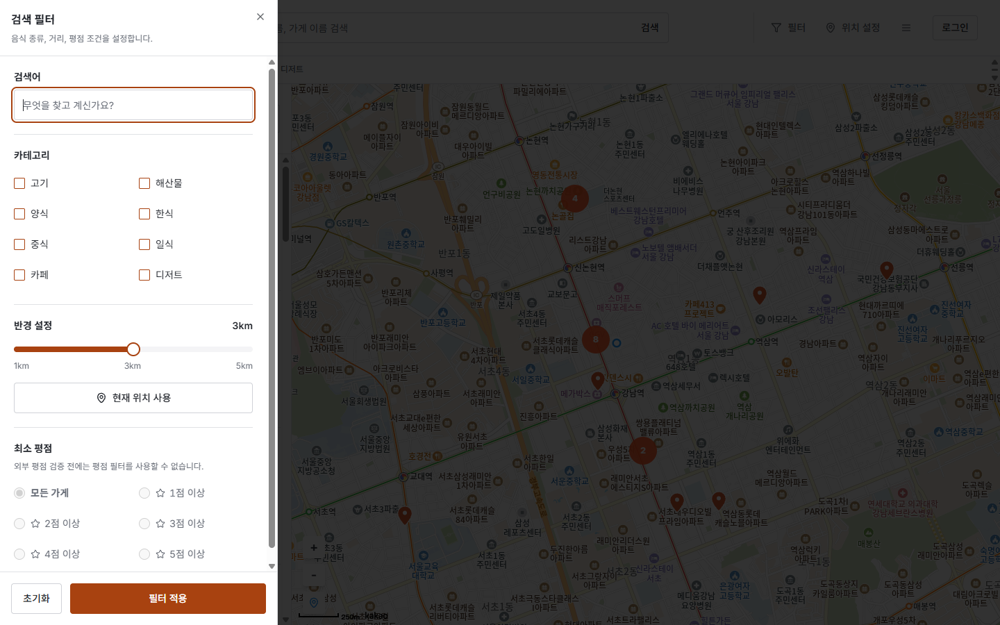
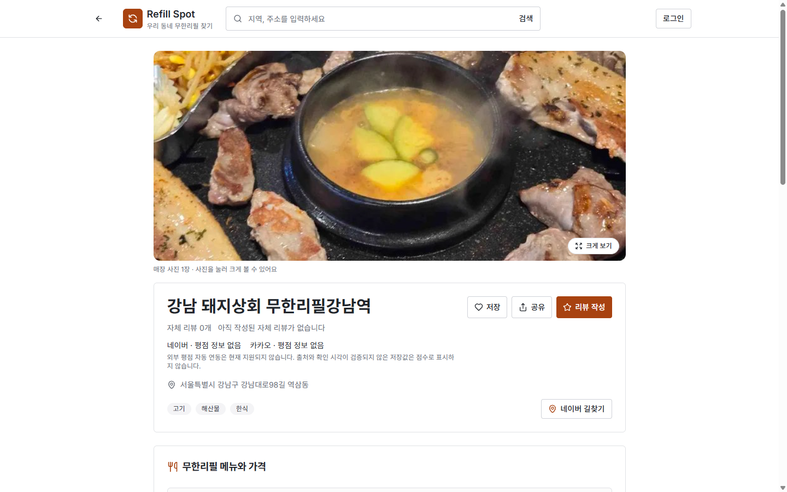
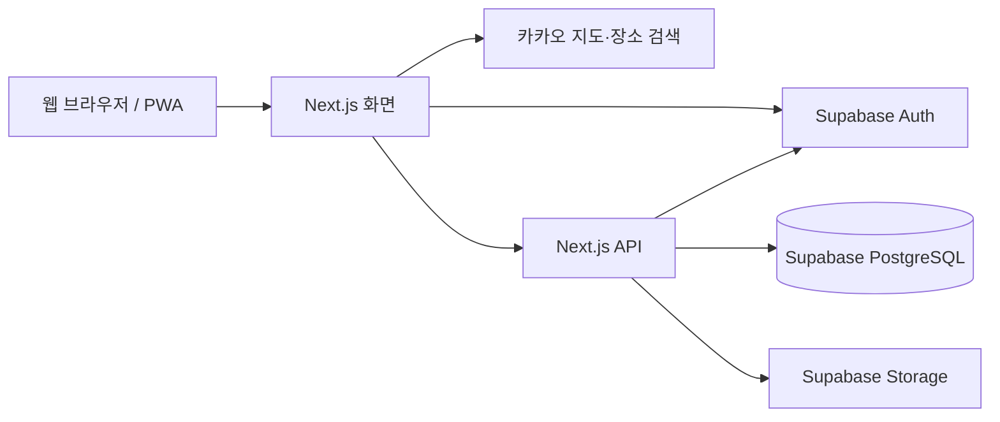

# Refill Spot

**주변 무한리필 음식점을 찾고, 원하는 곳을 저장하세요.**

위치와 음식 카테고리로 무한리필 음식점을 탐색하고, 지도와 목록에서 상세 정보를 확인하는
웹 서비스입니다. 마음에 드는 음식점은 즐겨찾기에 저장하고, 방문 경험을 리뷰로 남길 수 있습니다.

> **지원 범위:** 등록된 음식점 정보를 제공합니다. 전국 모든 매장을 포함하거나 정보의 최신성을 보장하지 않습니다.
> 자체 리뷰와 외부 평점은 구분하며, 네이버·카카오 평점 자동 수집과 외부 평점 필터는 현재 지원하지 않습니다.

[서비스 접속](https://refill-spot.vercel.app) · [화면 미리보기](#화면-미리보기) · [주요 기능](#주요-기능) · [시작하기](#시작하기) · [지원 범위와 제한](#지원-범위와-제한)

## 화면 미리보기

### 지도와 음식점 목록



등록된 음식점을 지도와 목록에서 함께 확인합니다.

### 검색 필터



음식 종류와 검색 반경을 고른 뒤 적용합니다. 외부 평점 필터는 사용할 수 없다는 안내를 표시합니다.

### 음식점 상세



매장 사진과 주소를 확인하고 저장·리뷰 작성·길찾기로 이동할 수 있습니다.

위 이미지는 배포 사이트의 **비로그인 공개 화면을 직접 캡처**한 것입니다.
데스크톱 화면의 원본 비율을 유지했으며, 표시된 매장 정보·가격·리뷰 수는 캡처 당시의 상태입니다.
화면 캡처는 매장 정보의 정확성이나 로그인 후 저장·리뷰 작성의 성공을 보증하지 않습니다.

## 왜 Refill Spot인가

무한리필 음식점을 찾을 때 필요한 **위치·음식 종류·방문할 곳의 정보**를 함께 살펴볼 수 있습니다.

- **주변에서 찾기:** 현재 위치나 검색한 장소를 기준으로 등록된 음식점을 탐색합니다.
- **조건으로 좁히기:** 음식 카테고리와 거리 조건을 적용해 지도와 목록에서 확인합니다.
- **다시 찾아보기:** 관심 있는 음식점을 즐겨찾기에 저장하고, 상세 화면에서 외부 지도와 길찾기로 연결합니다.

영업시간·가격·메뉴는 매장 사정에 따라 달라질 수 있으므로 방문 전 매장에 확인하세요.

## 사용 흐름

1. **위치 설정:** 브라우저에서 현재 위치를 허용하거나, 장소·주소를 검색해 결과를 선택합니다.
2. **조건 선택:** 음식 카테고리와 검색 반경을 정하고 필터를 적용합니다.
3. **상세 확인:** 지도 마커나 목록에서 음식점을 선택해 주소·메뉴·리뷰 등 등록된 정보를 읽습니다.
4. **방문 및 저장:** 외부 지도로 길찾기를 열거나, 로그인 후 즐겨찾기와 리뷰를 이용합니다.

장소·주소 검색은 검색 버튼 또는 Enter로 실행합니다. 현재 위치를 허용하지 않아도
검색한 장소를 선택해 탐색할 수 있습니다. 거리 필터는 기준 위치를 설정해야 사용할 수 있습니다.

## 주요 기능

| 기능 | 할 수 있는 일 |
| --- | --- |
| 음식점 탐색 | 지도·목록에서 등록된 무한리필 음식점 확인 |
| 위치 검색 | 카카오 장소·주소 검색, 현재 위치 기준 탐색 |
| 조건별 검색 | 고기·해산물·양식·한식·중식·일식·카페·디저트, 화면에서 1~5km 반경 선택 |
| 상세 정보 | 등록된 주소·전화번호·영업시간·메뉴 확인, 외부 지도·길찾기 연결 |
| 자체 리뷰 | 로그인 후 리뷰 작성·수정·삭제와 사진 첨부 |
| 즐겨찾기 | 로그인 후 관심 음식점 저장·관리 |
| 프로필 | 프로필 정보와 사진 변경 |
| 모바일 웹 | 반응형 화면, 지원 브라우저의 PWA 설치 기능 |

## 시작하기

### 서비스 이용

[Refill Spot](https://refill-spot.vercel.app)에 접속합니다.
음식점 검색과 정보 확인은 로그인 없이 이용할 수 있으며, 즐겨찾기·리뷰 등 개인화 기능에는 로그인이 필요합니다.
Google·Kakao 소셜 로그인 경로를 제공합니다.

현재 위치 기능에는 브라우저의 위치 권한이 필요합니다. 위치 정확도는 기기와 이용 환경에 따라 달라집니다.
PWA 설치 메뉴와 동작은 브라우저에 따라 다르며, 별도 네이티브 Android·iOS 앱을 뜻하지 않습니다.

### 개발자용 로컬 실행

Node.js와 pnpm, Supabase 프로젝트, 카카오 지도 JavaScript 키가 필요합니다.
Next.js 15의 최소 Node.js 요구사항은 18.18이지만, 실제 개발에는 지원 중인 Node.js LTS를 사용하세요.

```powershell
# 저장소 루트의 PowerShell
pnpm install --frozen-lockfile
Copy-Item .env.sample .env.local
```

기존 `.env.local`이 있다면 복사하지 말고 필요한 항목만 대조합니다.
[환경변수 예시](.env.sample)의 `**`와 예시 문자열을 실제 설정으로 바꿉니다.

| 설정 | 용도 및 주의사항 |
| --- | --- |
| `NEXT_PUBLIC_SUPABASE_URL`, `NEXT_PUBLIC_SUPABASE_ANON_KEY` | 브라우저용 Supabase 주소와 공개 anon 키 |
| `SUPABASE_URL`, `SUPABASE_ANON_KEY` | 서버용 Supabase 주소와 anon 키. 브라우저와 같은 프로젝트로 설정 |
| `NEXT_PUBLIC_KAKAO_API_KEY` | 지도·장소 검색에서 공유하는 카카오 JavaScript 키 |
| `SUPABASE_STORAGE_BUCKET_REVIEW_IMAGES` | 리뷰 사진 버킷. 미설정 시 `review-images` |
| `SUPABASE_STORAGE_BUCKET_PROFILE_IMAGES` | 프로필 사진 버킷. 미설정 시 `image` |
| 그 외 예시 항목 | 네이버 레거시 검색, 카카오 REST API, AdSense, 이미지 호스트 등 해당 기능을 사용할 때 설정 |

`NEXT_PUBLIC_*` 값은 브라우저에 노출됩니다. 서버 비밀키나 카카오 REST 키를 넣지 마세요.
Google Maps/Places 키는 위치 검색에 사용하지 않으며, Google 로그인·AdSense 설정과는 별개입니다.

실행 전 다음 외부 설정도 필요합니다.

1. **Supabase DB·Storage:** 애플리케이션이 사용하는 테이블·버킷과 RLS·Storage 정책을 준비합니다.
   저장소의 마이그레이션은 기존 DB를 보완하는 변경이며, 빈 프로젝트의 전체 초기화 절차가 아닙니다.
2. **로그인:** Supabase Auth에서 Google·Kakao 공급자를 설정하고, 실제 접속 주소의
   `/auth/callback`을 허용 리다이렉트 URL로 등록합니다. 각 공급자의 OAuth 설정도 맞춰야 합니다.
3. **카카오 지도:** JavaScript 키에 개발 주소 `http://localhost:3000`과 실제 서비스 도메인을 등록합니다.
   다른 포트를 사용하면 해당 포트의 주소도 등록합니다.

```powershell
pnpm dev
```

개발 서버: `http://localhost:3000`

**환경변수만 입력해도 새 Supabase 프로젝트가 자동으로 구성되지는 않습니다.**
DB 스키마·접근 정책·OAuth 설정이 없으면 조회·로그인·업로드가 정상 동작하지 않습니다.

### 검증 및 프로덕션 빌드

```powershell
pnpm test
pnpm run type-check
pnpm build
pnpm start
```

`pnpm start`는 성공한 프로덕션 빌드가 필요합니다. 위 명령은 검증 절차이며,
이 README 수정 과정에서 앱 테스트·빌드나 운영 배포를 완료했다는 의미는 아닙니다.
PWA 서비스 워커는 개발 서버에서는 비활성화되므로 프로덕션 빌드에서 확인해야 합니다.

## 지원 범위와 제한

| 구분 | 현재 범위 |
| --- | --- |
| 플랫폼 | 데스크톱·모바일 웹, 지원 브라우저에서 PWA 설치 |
| 음식점 데이터 | DB에 등록된 음식점만 제공. 지역별 매장 수·정보 완전성·최신성은 보장하지 않음 |
| 위치 검색 | 카카오 장소·주소 검색. 검색어 2~100자, 키워드 결과가 없을 때 주소 검색 추가 |
| 평점 | Refill Spot 자체 리뷰와 외부 평점 상태를 구분. 외부 평점 수집·비교·필터·정렬은 미지원 |
| 오프라인 | 오프라인 안내 제공. 개인화 데이터의 오프라인 조회·편집·동기화는 제공하지 않음 |
| 사진 삭제 | 리뷰·프로필의 사진 연결 변경과 저장소 파일의 실제 삭제를 구분. 안전한 자동 파일 정리는 미완료 |

### 외부 평점

기존 DB의 `naver_rating`·`kakao_rating`에는 출처·수집 시각이 없어 검증된 현재 평점으로 사용하지 않습니다.
`0`·누락은 정보 없음, 유효한 저장 점수는 미검증, 범위를 벗어난 값은 데이터 확인 필요로 구분합니다.
가게 수정 시각을 평점 확인 시각으로 대신 쓰거나, 외부 점수끼리 평균을 계산하지 않습니다.
외부 지도 링크 역시 앱 내 평점 비교 기능을 완성한 것으로 간주하지 않습니다.

평점 연동에는 평점·리뷰 수 제공과 재표시·저장 권한이 확인된 공급 경로가 필요합니다.
네이버 지역 검색 응답에는 평점 필드가 없으며, 카카오 공식 답변은 평점·리뷰 API 제공과 해당 데이터 제휴 검토가 불가하다고 안내합니다.
유료 검색 API 가입만으로 해결되지 않으며 비공식 상세 페이지 호출은 사용하지 않습니다.

- [네이버 지역 검색 응답 명세](https://api.ncloud-docs.com/docs/naver-api-hub-search-local)
- [카카오 평점·리뷰 관련 공식 답변](https://devtalk.kakao.com/t/kakao-maps-api-api/147942)

### 개인정보와 사진 관리

- 개인 API·이미지·RSC 응답과 페이지 이동은 서비스 워커에서 캐시하지 않습니다.
  새 서비스 워커 활성화 시 이전 버전의 개인화 런타임 캐시를 정리합니다.
- 리뷰 수정·삭제 후 분리된 사진은 무조건 삭제하지 않습니다.
  전역 참조와 동시 재첨부를 원자적으로 확인하는 정리 절차가 없어 `imageCleanup`에 보류 상태를 반환합니다.
- 리뷰 사진 일부 업로드가 실패해도 먼저 올라간 파일을 임의 삭제하지 않습니다.
  실패 응답은 HTTP 500이며 확인된 업로드 수와 파일 정리 보류 여부를 알립니다.
- 프로필 사진도 연결 변경 실패나 결과가 불명확한 상황에서는 파일을 삭제하거나 저장 성공으로 안내하지 않습니다.
  보류된 파일은 저장 공간을 계속 차지할 수 있으며, 실제 회수에는 참조 추적·재첨부 차단·권한을 검증한 삭제 작업자가 필요합니다.

## 구조와 기술 스택



| 영역 | 기술 |
| --- | --- |
| 웹 UI | Next.js 15, React 19, TypeScript, Tailwind CSS, Radix UI |
| 상태·입력 | Zustand, React Hook Form, Zod |
| 지도·위치 검색 | Kakao Maps JavaScript SDK |
| 인증·데이터·이미지 | Supabase Auth, PostgreSQL, Storage |
| PWA | Serwist, 오프라인 안내 페이지 |
| 검증 | Node.js 테스트 러너·tsx, TypeScript 타입 검사 |

위 그림은 주요 구성의 요약이며 모든 데이터 흐름이나 운영 배포 상태를 나타내지는 않습니다.

## 개발·배포 주의사항

### API와 외부 서비스

- `/api/*` 응답은 `private, no-store`를 사용합니다. 공개 가게 목록도 세션 쿠키를 갱신할 수 있어 공유 캐시를 사용하지 않습니다.
  인증 미들웨어는 SDK의 캐시 금지 헤더를 후속 응답과 리다이렉트에 유지합니다.
- 관리자 화면은 서버가 검증한 사용자와 관리자 프로필을 확인합니다.
  OAuth·비밀번호 복구는 검증한 내부 경로로만 이동합니다.
- 이미지 업로드는 인증·크기·파일 시그니처를 확인합니다. 확장자나 브라우저가 전달한 MIME 형식만 신뢰하지 않습니다.
- Supabase 타입 선언은 실제 DB 권한을 보장하지 않습니다. 배포 전 RLS·Storage 정책과 계정별 접근 권한을 확인해야 합니다.
- `GET /api/stores/ratings`는 `503 EXTERNAL_RATINGS_UNAVAILABLE`을 반환합니다.
  양수 `minRating` 또는 `sort=rating`을 요청한 가게 조회도 명시적으로 거절합니다.
- 장소 검색 결과는 DB·localStorage에 저장하지 않습니다. 입력 중 조회·자동 재시도·선택 후 상세 재조회는 하지 않습니다.
  늦은 응답은 현재 선택을 덮어쓰지 않도록 처리하지만, 요청 취소가 이미 사용한 쿼터를 되돌리지는 않습니다.
  호출 제한·인증 오류는 빈 결과로 숨기지 않습니다. 실제 쿼터는 [카카오 공식 안내](https://developers.kakao.com/docs/latest/ko/getting-started/quota)와 앱 콘솔에서 확인하세요.
- 의존성 점검은 `pnpm audit --prod`로 수행합니다. 패치되지 않은 전이 의존성 경고를 무시 목록으로 숨기지 않으며,
  `package.json`의 보안 패치 overrides는 실제 빌드와 함께 검증해야 합니다.

### 기존 운영 반영 기록

아래는 **기존 README에 남아 있던 운영 기록**을 보존한 것입니다.
이번 문서 수정에서 운영 환경을 다시 조회한 결과가 아니므로 최신 배포 상태로 단정하지 마세요.

| 변경 | 기존 기록 |
| --- | --- |
| [001: 프로필 역할 보호](supabase/migrations/202610110001_protect_profile_roles.sql) | 운영 SQL 수동 적용. 일반 사용자의 `role`·`is_admin` 변경 차단, 본인 이름·사진·소개 수정 유지 |
| [002: 문의 접근 정책](supabase/migrations/202610110002_secure_contacts.sql) | `cc5c4c1` 재빌드·승격 후 운영 SQL 수동 적용. 공개 키 조회 차단·익명 INSERT 롤백 검증, 검증 행 미보존 |
| [003: 매장 이미지 업로드 제한](supabase/migrations/202610110003_restrict_store_uploads.sql) | SQL 편집기 소유자 오류 후 공식 Storage 정책 UI 적용. 기존 정책 이름·공개 조회 유지, INSERT 역할을 `authenticated`로 제한. DB 정책 조회로 역할·버킷 조건 재확인 |
| [004: 사용자별 가게 리뷰 고유성](supabase/migrations/202610110004_unique_user_store_reviews.sql) | 중복 그룹이 없음을 확인하고 운영 SQL 수동 적용. `(user_id, store_id)` 고유 제약 추가, 기존 리뷰 수정·삭제 없음 |

**실제 스키마와 마이그레이션 이력을 대조하기 전 전체 마이그레이션을 실행하지 마세요.**
001·002·004는 SQL 수동 실행, 003은 정책 UI 적용 기록이며 Supabase 마이그레이션 이력과의 동기화는 확인되지 않았습니다.
002·004 재실행은 기존 정책·제약과 충돌할 수 있습니다.

기록 당시 운영 코드 기준은 `cc5c4c1`이며, 이후 로컬의 리뷰 업로드·프로필 사진 삭제 보호 수정은
해당 배포에 포함되지 않은 상태였습니다. 저장소의 구현과 실제 운영 반영 여부는 별도로 확인해야 합니다.

## 문의 및 라이선스

- 문의: [refillspot.official@gmail.com](mailto:refillspot.official@gmail.com)
- 버그 신고: [GitHub Issues](https://github.com/Refill-Spot/Refill-spot/issues)
- 소스코드: [MIT License](LICENSE), Copyright (c) 2025 Refill Spot Team
